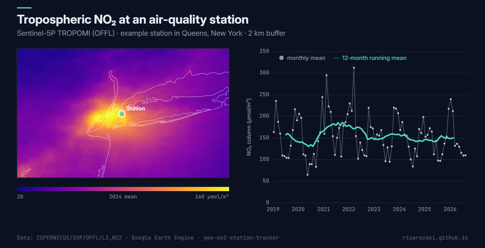

# NO₂ Station Tracker

Track **tropospheric nitrogen dioxide (NO₂)** at air-quality monitoring stations with Sentinel-5P TROPOMI in Google Earth Engine. You get a multi-station time-series chart, a map of mean NO₂, and a tidy CSV ready for analysis in Python, R or Excel.

Example output: 2024 mean NO₂ around New York and the monthly series at one station (2019–2026), from Sentinel-5P in Earth Engine.

## What the script does

| Step | Output |
|---|---|
| Averages every TROPOMI overpass into daily or monthly means at each station (optionally within a buffer) | `ImageCollection` of NO₂ means |
| Plots all stations on one chart | Console chart |
| Maps the period-mean NO₂ field | Map layer |
| Writes one row per station and time step | CSV in Google Drive |

## Quick start

1. Open the [Earth Engine Code Editor](https://code.earthengine.google.com).
2. Paste [`no2_station_tracker.js`](no2_station_tracker.js) into a new script.
3. Edit the `CONFIG` block (stations, dates, product, time step).
4. Press **Run**, then start the export from the **Tasks** tab.

## Configuration

| Parameter | Default | Description |
|---|---|---|
| `stations` | one example station | List of `{name, lon, lat}` |
| `STATIONS_ASSET` | `null` | Use a point `FeatureCollection` asset instead of the list |
| `STATION_NAME_FIELD` | `'name'` | Property holding the station name in the asset |
| `startDate` / `endDate` | `2019-01-01` / today | Analysis period (TROPOMI starts mid-2018) |
| `product` | `'OFFL'` | `OFFL` (consistent archive, best for trends) or `NRTI` (near-real-time) |
| `step` | `'month'` | `'day'` or `'month'` aggregation |
| `bufferMeters` | `2000` | Averaging radius around each station; `0` = single pixel |
| `exportToDrive` | `true` | Create the CSV export task |

## Output

`no2_station_timeseries.csv`

| column | description |
|---|---|
| `station` | station name |
| `date` | `YYYY-MM` or `YYYY-MM-dd` |
| `NO2_umol_m2` | mean tropospheric NO₂ column (µmol/m²) |
| `n_overpasses` | number of TROPOMI images in that time step |

## Notes

- The script uses the **tropospheric** NO₂ column, which is closer to near-surface pollution than the total column.
- Values are converted from mol/m² to µmol/m² for readability (1 mol/m² = 10⁶ µmol/m²).
- Cloud-affected pixels are already removed in the L3 product; time steps with no valid image are skipped.
- Satellite column amounts are not the same as station surface concentrations, but their temporal patterns usually agree well.

## Data

Copernicus Sentinel-5P TROPOMI Level-3 NO₂ ([OFFL](https://developers.google.com/earth-engine/datasets/catalog/COPERNICUS_S5P_OFFL_L3_NO2) / [NRTI](https://developers.google.com/earth-engine/datasets/catalog/COPERNICUS_S5P_NRTI_L3_NO2)), European Space Agency / Copernicus.

## Author

**Parisa Abbasalizadehrezaei** · [risarezaei.github.io](https://risarezaei.github.io)

Released under the [MIT License](LICENSE).
